<!-- Ash & iron profile, short edition. Projects, skills, stack and stats live at https://bonfireos.pages.dev -->

  

  

    
    
    
  

  

    <strong>Backend &amp; systems engineer.</strong> I build services that keep running long after the bonfire has gone out. 
    Linux · Python · TypeScript · Rust · Docker · clean architecture, small diffs, no undefined behaviour.
  

  

  
  
<em>Projects, character sheet, armament and soul memory are kept in the world above.</em>

  

    
  

  

  
<em>Leave a summon sign — I answer most of them.</em>

  

    
    
  

  

